<div align="center">


# Plexamp Now Playing

**A now-playing overlay for OBS that shows what you're listening to in Plexamp, in 23 hand-built themes.**

From a Plex-style card that colors itself from each album to a spinning vinyl record, a mixtape, a split-flap departures board and a neon sign on a brick wall.

[](https://obsproject.com)
[](https://www.plex.tv/plexamp/)
[](#-the-themes)
[](LICENSE)

[**Download**](../../releases/latest) · [Install](#-install) · [Themes](#-the-themes) · [Style Studio](#-style-studio) · [Presets & hotkeys](#-presets--hotkeys) · [Troubleshooting](#-troubleshooting)

<br>

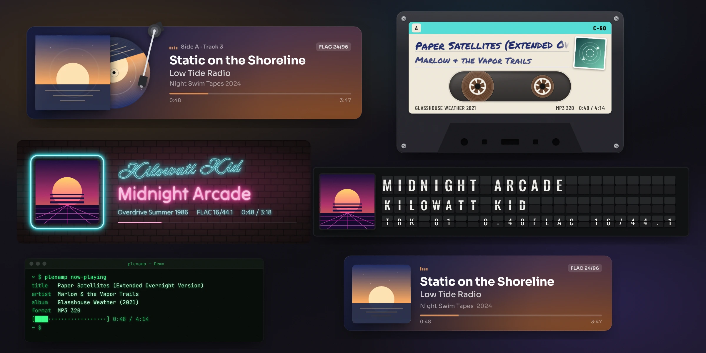

</div>

<br>

<table>
  <tr>
    <td width="33%" align="center">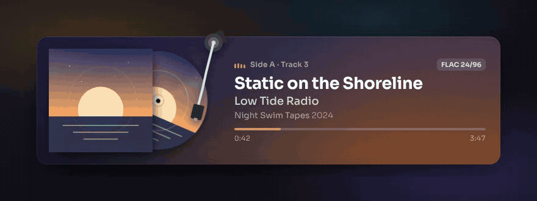<br><sub><b>Vinyl</b>: the record swaps out on every song change</sub></td>
    <td width="33%" align="center">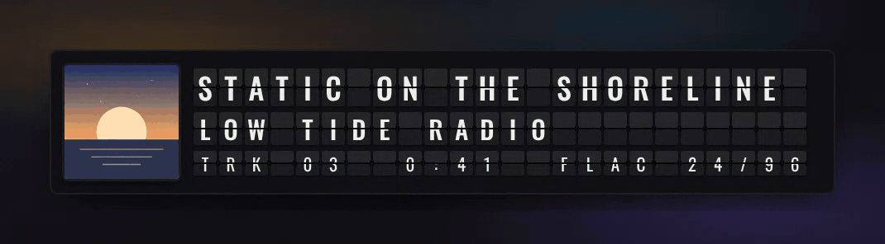<br><sub><b>Split-flap</b>: letters flip into place</sub></td>
    <td width="33%" align="center">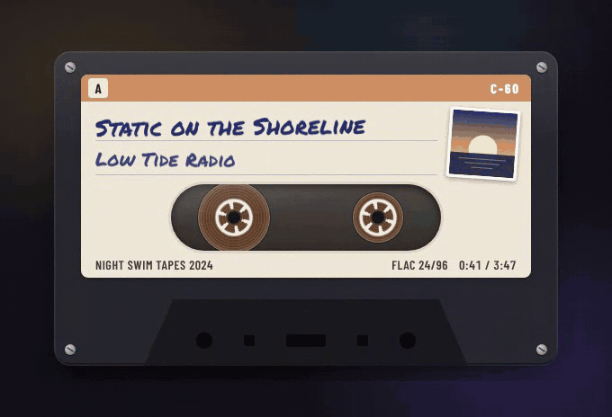<br><sub><b>Cassette</b>: fast-forwards and rewrites the label</sub></td>
  </tr>
</table>

## ✨ Features

- **23 themes, 83 styles.** Modern cards, broadcast lower thirds, physical media (vinyl, cassette, CD, Polaroid, ticket, receipt), retro tech (Winamp-style skin, terminal, car stereo, split-flap, pixel RPG), neon, synthwave, Y2K glass, brutalist, synced lyrics and a full visualizer.
- **Colors from the album.** Uses Plex's own UltraBlur colors for each album, so the card changes mood with every record. Or pick one of ten palettes, the theme's own colors, or your own hex codes.
- **Reacts to the music.** Visualizer bars, pulsing covers and glowing neon follow the song's real loudness curve from Plex's audio analysis, so nothing needs to capture your audio.
- **Synced lyrics.** Karaoke-style line fill from your Plex server's lyrics (LyricFind with Plex Pass, or `.lrc` files next to your music).
- **Real audio details.** Shows the actual format, like `FLAC 24/96` or `MP3 320`, plus genre, star rating, play count and the device that's playing.
- **Mix and match everything.** 35 fonts, 9 moving backgrounds, 9 effects (VHS, CRT, 8mm film, holographic…), 11 entrance animations, 8 song-change animations, 6 progress styles and more, on any theme.
- **Style Studio.** A live designer page with every theme previewed side by side. Send looks straight to OBS over obs-websocket, or copy a short style code.
- **Presets and hotkeys.** Save looks by name and switch between them from the OBS panel, the Studio, or hotkeys `Preset 1` to `Preset 10`.
- **Stays out of the way.** Hides itself when you pause, can pop up only on song changes, and swaps looks with a smooth exit-and-enter instead of a hard cut.
- **Plexamp's own visualizer, too.** One button adds a blended capture of Plexamp's visualizer window, with a hotkey to toggle it.
- **Nothing to install.** One Lua script and two HTML files. No plugins, no Node, no server, no accounts. It talks to your Plex server directly.

## 🎨 The themes

Every theme below is shown with the built-in test card (made-up songs and cover art), so you can preview them without Plex running.

<table>
  <tr>
    <td width="50%" valign="top">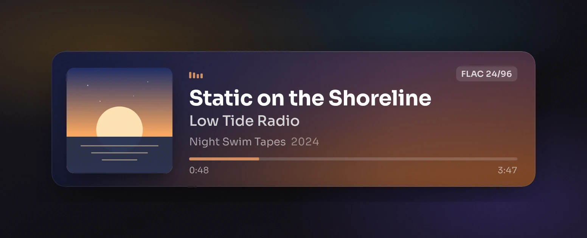<br><b>Ultrablur</b> &nbsp;<sub><code>Modern</code></sub><br><sub>Plex-style card that takes its colors from each album.</sub><br><sub><i>Styles: Card · Tall · Edge-to-edge cover · Floating cover</i></sub></td>
    <td width="50%" valign="top">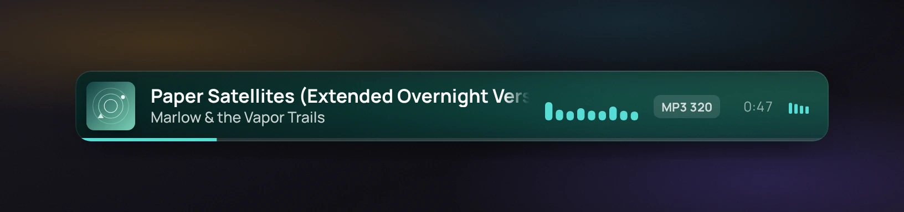<br><b>Slim bar</b> &nbsp;<sub><code>Modern</code></sub><br><sub>A thin strip that fits along the edge of your stream.</sub><br><sub><i>Styles: Album colors · Dark · Light</i></sub></td>
  </tr>
  <tr>
    <td width="50%" valign="top">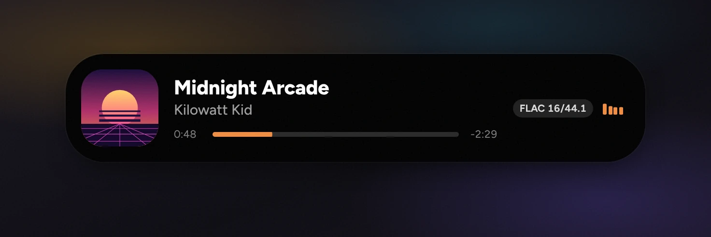<br><b>Island</b> &nbsp;<sub><code>Modern</code></sub><br><sub>A black pill that opens up when the song changes, then tucks itself away.</sub><br><sub><i>Styles: Opens on song change · Always open · Always compact</i></sub></td>
    <td width="50%" valign="top">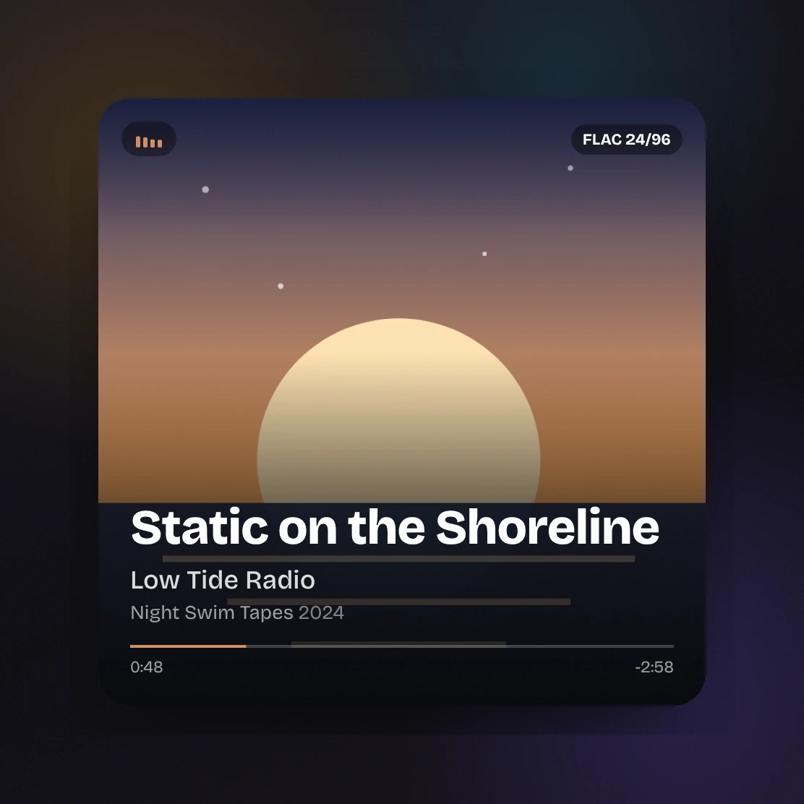<br><b>Spotlight</b> &nbsp;<sub><code>Modern</code></sub><br><sub>The cover takes the whole card and drifts slowly, with the song set over it.</sub><br><sub><i>Styles: Square · Poster · Round cover</i></sub></td>
  </tr>
  <tr>
    <td width="50%" valign="top">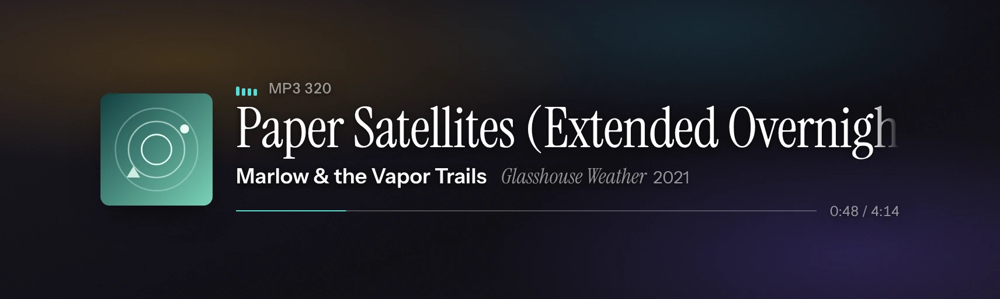<br><b>Minimal</b> &nbsp;<sub><code>Modern</code></sub><br><sub>Just type over your stream, no box. An editorial serif with a hairline that tracks the song.</sub><br><sub><i>Styles: Left aligned · Right aligned · Centered</i></sub></td>
    <td width="50%" valign="top">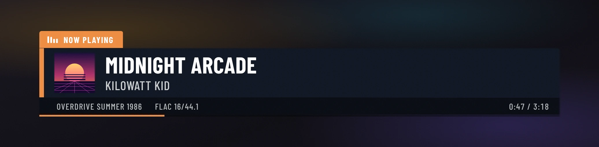<br><b>Lower third</b> &nbsp;<sub><code>Broadcast</code></sub><br><sub>TV-style lower third. An accent bar wipes in and the song slides off a tab.</sub><br><sub><i>Styles: Dark · Light · Accent color</i></sub></td>
  </tr>
  <tr>
    <td width="50%" valign="top">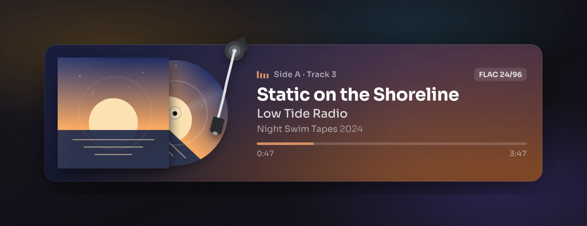<br><b>Vinyl</b> &nbsp;<sub><code>Physical media</code></sub><br><sub>The record slides out of its sleeve and the tonearm drops onto it. It lifts when you pause.</sub><br><sub><i>Styles: Black vinyl · Colored vinyl · Splatter · Picture disc</i></sub></td>
    <td width="50%" valign="top">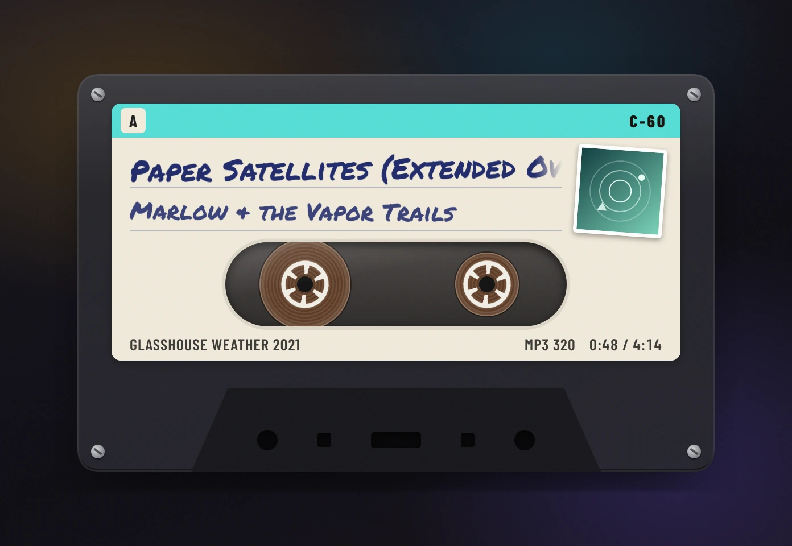<br><b>Cassette</b> &nbsp;<sub><code>Physical media</code></sub><br><sub>A mixtape with a handwritten label. The tape winds from one reel to the other as the song plays.</sub><br><sub><i>Styles: Smoke shell · Black shell · White shell · Clear aqua · Red shell · Album-art label</i></sub></td>
  </tr>
  <tr>
    <td width="50%" valign="top">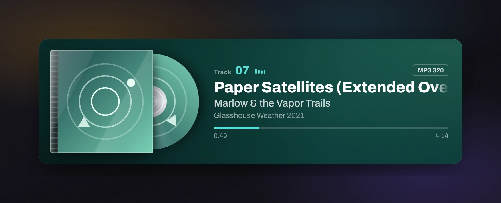<br><b>CD</b> &nbsp;<sub><code>Physical media</code></sub><br><sub>A jewel case with the disc sliding out. Choose the printed side or the rainbow side.</sub><br><sub><i>Styles: Printed disc · Rainbow side · Disc only</i></sub></td>
    <td width="50%" valign="top">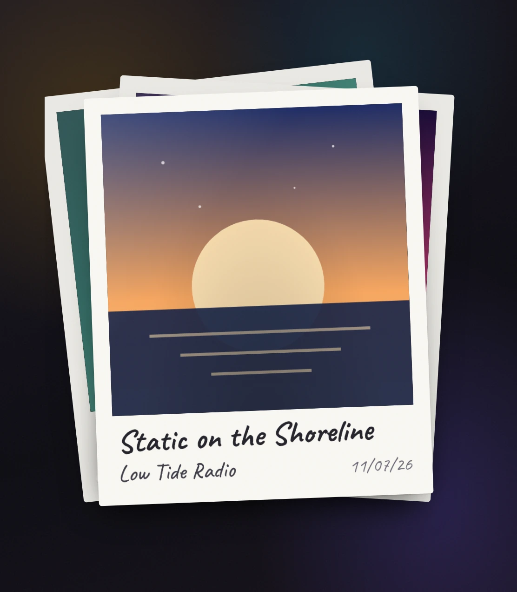<br><b>Polaroid</b> &nbsp;<sub><code>Physical media</code></sub><br><sub>Every song is an instant photo that develops in front of you and lands on the pile.</sub><br><sub><i>Styles: Photo pile · Single photo · Taped to the wall</i></sub></td>
  </tr>
  <tr>
    <td width="50%" valign="top">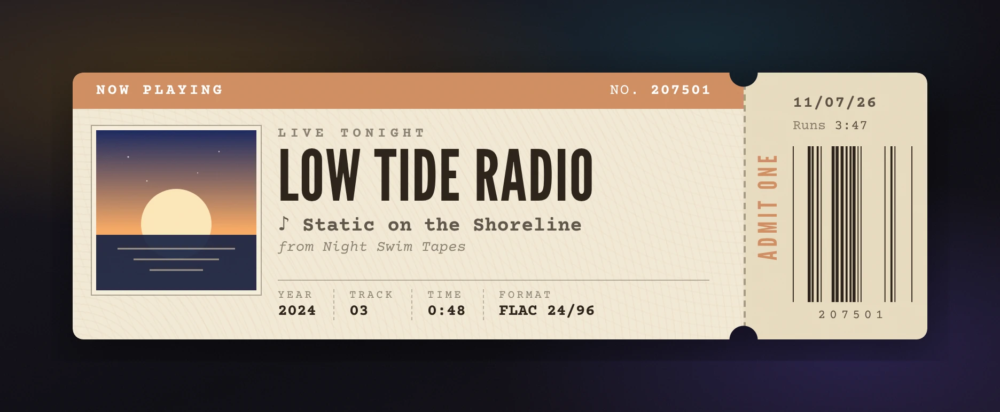<br><b>Ticket</b> &nbsp;<sub><code>Physical media</code></sub><br><sub>A concert ticket with the artist as headliner. The stub tears off when the song changes.</sub><br><sub><i>Styles: Cream paper · White paper · Holographic foil · Kraft paper</i></sub></td>
    <td width="50%" valign="top">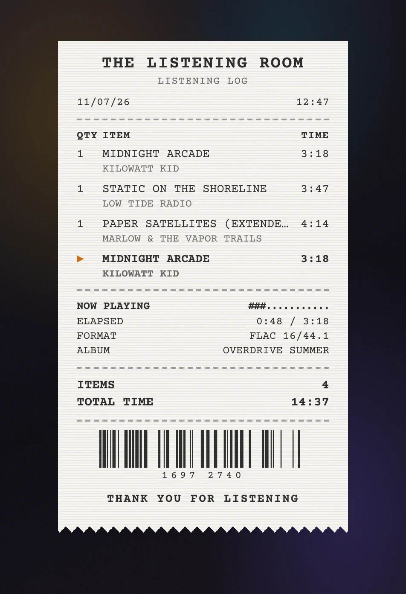<br><b>Receipt</b> &nbsp;<sub><code>Physical media</code></sub><br><sub>A thermal-printer receipt of what you&#x27;ve been playing. Each new song prints a line and feeds the paper.</sub><br><sub><i>Styles: Thermal paper · Old and faded · Long receipt</i></sub></td>
  </tr>
  <tr>
    <td width="50%" valign="top">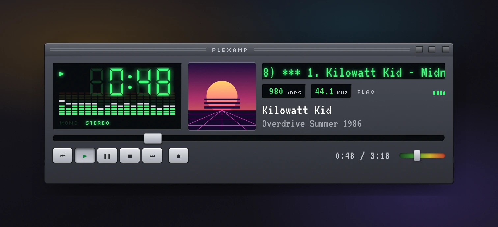<br><b>Retro Amp</b> &nbsp;<sub><code>Retro tech</code></sub><br><sub>An early-2000s desktop player skin with seven-segment time, a scrolling title and a level meter.</sub><br><sub><i>Styles: Classic gray · Midnight blue · Brushed gold · Album skin</i></sub></td>
    <td width="50%" valign="top">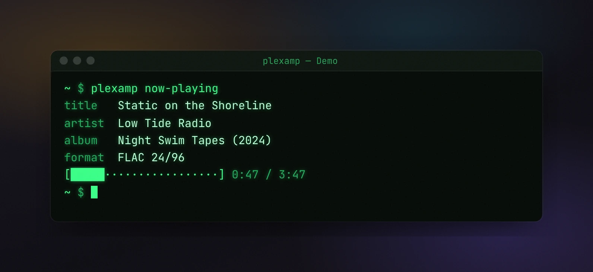<br><b>Terminal</b> &nbsp;<sub><code>Retro tech</code></sub><br><sub>A shell window that types out what&#x27;s playing every time the song changes.</sub><br><sub><i>Styles: Green phosphor · Amber · Modern dark · Light</i></sub></td>
  </tr>
  <tr>
    <td width="50%" valign="top">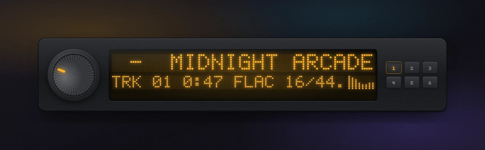<br><b>Car stereo</b> &nbsp;<sub><code>Retro tech</code></sub><br><sub>A late-night car stereo with a dot-matrix display. The volume knob turns as the song plays.</sub><br><sub><i>Styles: Amber · Ice blue · Green · Red · White</i></sub></td>
    <td width="50%" valign="top">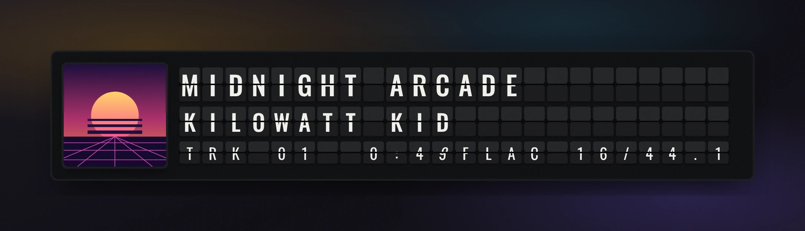<br><b>Split-flap board</b> &nbsp;<sub><code>Retro tech</code></sub><br><sub>A station departures board. The letters flip into place and the clock flips every second.</sub><br><sub><i>Styles: Classic black · Amber letters · Station blue · White tiles</i></sub></td>
  </tr>
  <tr>
    <td width="50%" valign="top">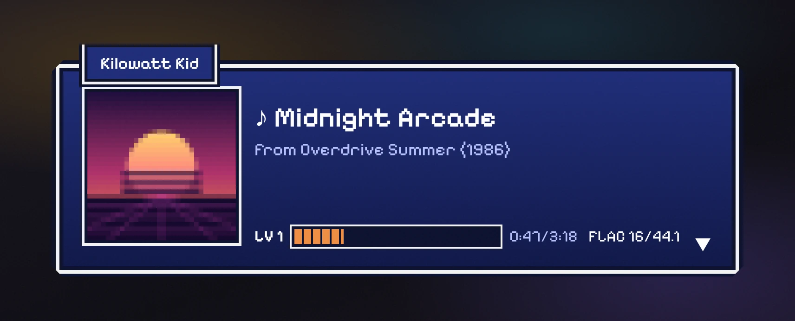<br><b>Pixel RPG</b> &nbsp;<sub><code>Retro tech</code></sub><br><sub>An RPG dialog box. The artist speaks, the cover is pixel art, and the song fills an XP bar.</sub><br><sub><i>Styles: Classic blue · Pocket green · Black and white · Album colors</i></sub></td>
    <td width="50%" valign="top">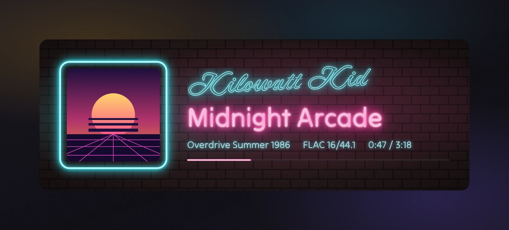<br><b>Neon sign</b> &nbsp;<sub><code>Night</code></sub><br><sub>A neon sign on a brick wall. The letters flicker on for every new song and glow brighter when the music gets loud.</sub><br><sub><i>Styles: Brick wall · Dark wall · No wall</i></sub></td>
  </tr>
  <tr>
    <td width="50%" valign="top">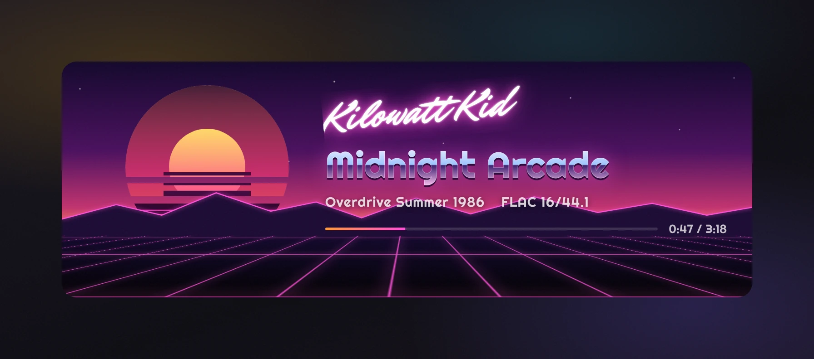<br><b>Synthwave</b> &nbsp;<sub><code>Night</code></sub><br><sub>The album cover becomes a striped sunset sun over a moving neon grid, with chrome lettering.</sub><br><sub><i>Styles: Sunset · Midnight · Miami</i></sub></td>
    <td width="50%" valign="top">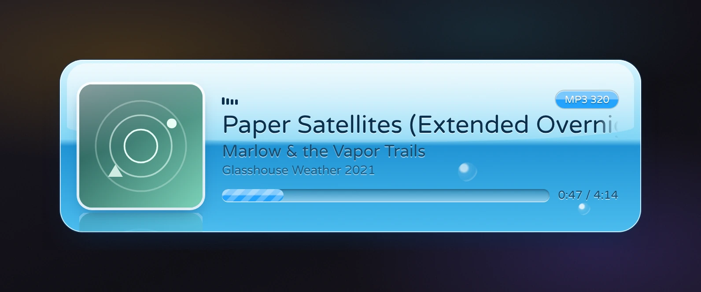<br><b>Aero</b> &nbsp;<sub><code>Y2K</code></sub><br><sub>Glossy early-2000s glass with bubbles, a reflection under the cover and a striped progress bar.</sub><br><sub><i>Styles: Aqua · Lime · Bubblegum · Silver</i></sub></td>
  </tr>
  <tr>
    <td width="50%" valign="top">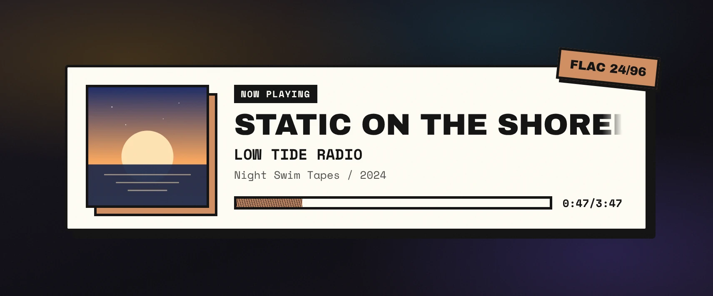<br><b>Brutalist</b> &nbsp;<sub><code>Graphic</code></sub><br><sub>Thick black lines, hard shadows and a sticker for the audio format. Loud on purpose.</sub><br><sub><i>Styles: Paper · Ink · Album color</i></sub></td>
    <td width="50%" valign="top">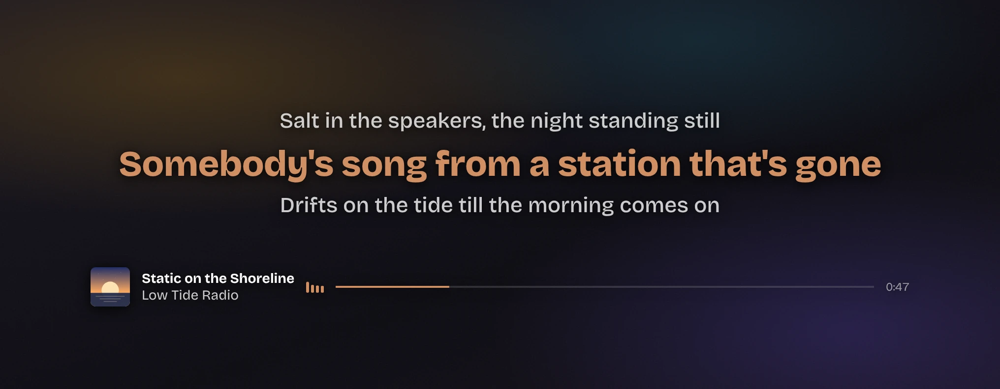<br><b>Lyrics</b> &nbsp;<sub><code>Karaoke</code></sub><br><sub>Synced lyrics from your Plex server, with each line filling in as it&#x27;s sung. Without lyrics it shows the song.</sub><br><sub><i>Styles: Three lines · One big line · TV subtitles</i></sub></td>
  </tr>
  <tr>
    <td width="50%" valign="top">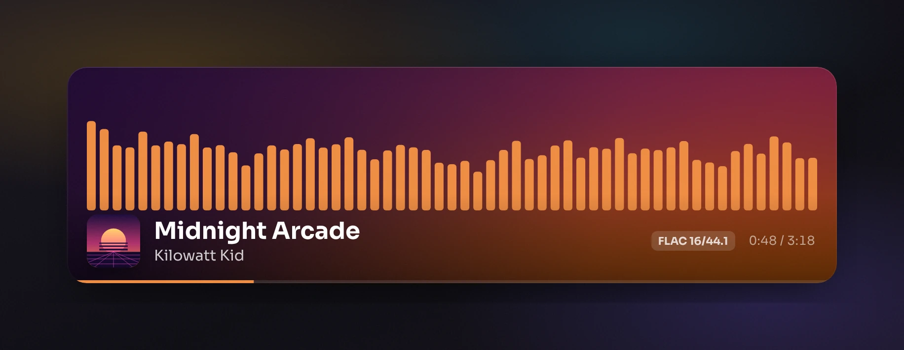<br><b>Visualizer</b> &nbsp;<sub><code>Karaoke</code></sub><br><sub>A big visualizer driven by Plex&#x27;s loudness analysis of the song. The round version wraps around the cover.</sub><br><sub><i>Styles: Bars · Mirrored · Wave · Round</i></sub></td>
    <td width="50%" valign="middle" align="center"><sub>Got an idea for theme 24?<br><a href="../../issues/new?template=theme_idea.md">Suggest a theme →</a></sub></td>
  </tr>
</table>

## 📦 Install

**You need:** OBS Studio 28 or newer (Windows, macOS or Linux), a Plex Media Server with a music library, and Plexamp.

1. **Download** the latest release zip from [Releases](../../releases/latest) (or click **Code → Download ZIP** on this page) and unzip it somewhere permanent, for example `D:\OBS\plexamp-now-playing\`. Keep these three files together in one folder:
   ```
   plexamp-now-playing.lua         ← the OBS script (settings panel, hotkeys)
   plexamp-now-playing.html        ← the overlay itself
   plexamp-style-studio.html       ← the Style Studio
   ```
2. In OBS, open **Tools → Scripts**, click **+** and pick `plexamp-now-playing.lua`.
3. Under **Plex connection**, fill in:
   - **Plex server address**: your server's local IP and port, like `192.168.1.20:32400`.
   - **Plex token**: see [Finding your Plex token](#finding-your-plex-token) below.
4. Click **Add overlay to current scene**. Play a song in Plexamp and it appears.
5. Pick a theme under **Look**, or click **Open the Style Studio** to design one.

> [!TIP]
> Turn on **Test card** under **Behavior** to style the overlay with fake songs, without playing anything. Turn **Show setup messages** off once everything works.

### Finding your Plex token

1. Open Plex Web and sign in.
2. Open any song or album, click **⋯ → Get Info → View XML**.
3. In the address bar of the page that opens, copy everything after `X-Plex-Token=`.

You can also paste that whole URL into the token box; the script pulls the token out for you.

> [!CAUTION]
> Your token works like a password for your Plex account. Don't show the OBS Scripts window on stream, and don't share `config.json` or `config.js`. The script writes those files next to itself, and they're in `.gitignore` here so they never end up in a repo.

## 🖌️ Style Studio

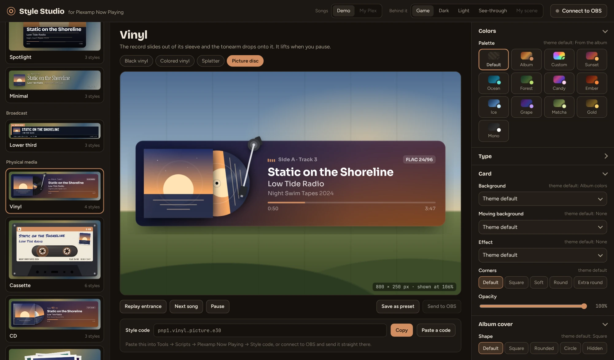

Click **Open the Style Studio** in the script panel (it opens in your web browser). Pick a theme from the gallery, choose a style, and fine-tune colors, type, background, effects, cover shape and motion, progress and visualizer, animations and what's shown. Everything previews live, over a game scene, a dark or light background, a see-through checkerboard, or a screenshot of your real OBS scene.

**Getting a look into OBS:**

- **Send it directly.** In OBS, open **Tools → WebSocket Server Settings**, tick **Enable WebSocket server**, then click **Show Connect Info** and copy the password. In the Studio, click **Connect to OBS** and paste it. With **Send every change live** on, the overlay updates as you tweak.
- **Or copy the style code.** Every look is a short code like `pnp1.vinyl.picture.eyJ…`. Click **Copy** and paste it into **Style code** in the script panel. Codes are handy for sharing looks with other streamers too.

Switch **Songs** to **My Plex** to preview with what you're actually playing.

## 🎛️ Presets & hotkeys

Save a look under a name and switch to it any time:

- **In OBS:** type a name under **Presets** and click **Save the current look as a preset**. Pick a preset from the list to switch to it, and rename, reorder, overwrite or delete from the same group.
- **In the Studio:** click **Save this look**. While connected to OBS, presets go straight into OBS; without a connection they're kept in the browser until you click **Add to OBS**.

Presets are stored in `presets.json` next to the script, so they survive reinstalls and you can back them up. To try the four example looks, copy [`examples/presets.json`](examples/presets.json) next to the script.

Set these in **Settings → Hotkeys** (search for "Plexamp"):

| Hotkey | What it does |
| --- | --- |
| `Plexamp: Show/hide now playing` | Toggles the overlay in the current scene |
| `Plexamp: Preset 1` … `Preset 10` | Switches to that preset |
| `Plexamp: Next preset` / `Previous preset` | Cycles through your presets |
| `Plexamp: Next theme` / `Previous theme` | Cycles through all 23 themes, keeping your other settings |
| `Plexamp: Toggle visualizer` | Shows or hides the Plexamp visualizer capture |

## 🌊 Plexamp's visualizer

Plexamp has its own gorgeous visualizer. Open Plexamp, switch its visualizer on, then click **Turn Plexamp visualizer on / off** in the script panel. That adds a window capture of Plexamp to the current scene with **Screen** blending, so the dark background drops away and only the visuals show. Crop it by holding **Alt** and dragging its edges. Choose another blend mode and a fade length in the same group.

Keep Plexamp open (it can sit behind other windows), but don't minimize it, or there's nothing to capture.

## ⚙️ Settings reference

<details>
<summary><b>Plex connection</b></summary>

| Setting | Notes |
| --- | --- |
| Plex server address | IP and port. `http://` and `:32400` are added if you leave them out. |
| Plex token | See [Finding your Plex token](#finding-your-plex-token). |
| Plex account to follow | Blank follows the server owner. Type a Plex username to follow someone else, or `*` for anyone. |
| Only this device | Part of a player's name, if you play on several devices and only want one shown. |
| Only Plexamp | Ignore music played in other Plex apps. |

</details>

<details>
<summary><b>Behavior</b></summary>

| Setting | Notes |
| --- | --- |
| Hide when paused | Slides the overlay away after the delay you set. |
| Only pop up on song change | Shows the overlay for a few seconds when a new song starts, then hides it. |
| When Plexamp stops | Hide, or keep showing the last song. |
| Lyrics timing nudge | Shifts synced lyrics earlier or later if they drift. |
| Test card | Plays three made-up songs so you can style without Plex. |
| Render size (Size & sharpness) | Draws the overlay at up to 3× resolution, so it stays sharp when scaled up on 1440p or 4K canvases. |

</details>

<details>
<summary><b>Look options</b> (also in the Style Studio)</summary>

| Option | Choices |
| --- | --- |
| Colors | From the album, the theme's own, Custom hex, Sunset, Ocean, Forest, Candy, Ember, Ice, Grape, Matcha, Gold, Mono |
| Font | 34 Google Fonts, from Sora and Fraunces to VT323 and Press Start 2P, or your system font |
| Card background | Album colors, blurred album art, dark glass, solid, two-tone gradient, transparent |
| Moving background | Color flow, aurora, bokeh, floating dust, starfield, rain, snow, waves, retro grid |
| Effect | Accent glow, VHS, 8mm film, CRT, scanlines, film grain, holographic, chromatic split, black & white |
| Album cover | Square, rounded, circle, hidden; float, tilt, pulse or glow to the music, spin |
| Progress | Bar, thin line, waveform, LED blocks, dots, ring around the cover |
| Visualizer bars | Bars, mirrored, line, dots, LED blocks |
| Animations | 11 show/hide animations, 7 song-change animations plus each theme's signature move, 5 text effects |

</details>

## 🧩 How it works

```
 Plexamp ──plays──▶ Plex Media Server ◀──polls /status/sessions── plexamp-now-playing.html (OBS Browser Source)
                                                                         ▲
 OBS Scripts panel ──writes──▶ config.json / config.js ─────────────────┘ (picked up live)
 Style Studio ──obs-websocket──▶ overlay source settings ──▶ script ──▶ config.json
```

- The overlay is a single HTML page loaded as a local Browser Source. Once a second it asks your Plex server what's playing, then pulls album colors, loudness levels and lyrics for that track. Everything stays on your network.
- The Lua script owns the settings panel and hotkeys. It writes `config.json` (and a `config.js` copy for `file://` pages), which the overlay re-reads live, so changes show up without reloading.
- The Style Studio stores the look you send on the overlay's browser source; the script notices and saves it as your style code.

## 🛠️ Troubleshooting

<details>
<summary><b>"Can't reach Plex at …"</b></summary>

Check the address and port (usually `:32400`) and that the OBS PC can reach the server. Use the server's local IP, not `app.plex.tv`.
</details>

<details>
<summary><b>"Plex rejected the token (401)"</b></summary>

Tokens change when you sign out of Plex everywhere. Grab a fresh one with the steps in [Finding your Plex token](#finding-your-plex-token).
</details>

<details>
<summary><b>"Connected, but no music matches your account filter"</b></summary>

The message lists who's playing what. If it's you on another account or another app, set **Plex account to follow** to your username, or `*`, or untick **Only Plexamp**.
</details>

<details>
<summary><b>The visualizer bars look generic</b></summary>

They use Plex's loudness analysis. In Plex, open **Settings → Library** and set **Analyze audio tracks for loudness** (the exact wording can vary by server version), then give Plex time to analyze your music. Until then the overlay uses a gentle synthetic beat.
</details>

<details>
<summary><b>No lyrics</b></summary>

Lyrics come from your Plex server: LyricFind lyrics with Plex Pass, or `.lrc` / embedded lyrics next to your music files. Set **Lyrics line** to *One line* or *Karaoke fill*, or use the Lyrics theme.
</details>

<details>
<summary><b>The overlay looks blurry</b></summary>

Raise **Render size** (under **Size & sharpness**) to 2× or 3×, then scale the source back down in your scene.
</details>

<details>
<summary><b>The Style Studio didn't open</b></summary>

The message under the button has the file's address. Paste it into your browser's address bar. It can also open behind OBS, so check the taskbar.
</details>

<details>
<summary><b>Why no color pickers in the OBS panel?</b></summary>

OBS 32.2.2's Scripts window crashes on color pickers and password fields, so the panel sticks to text boxes, lists and sliders. Hex codes work everywhere, and the Style Studio has real color pickers.
</details>

## 🤝 Contributing

Bug reports and theme ideas are welcome in [Issues](../../issues). Themes are self-contained `PNP.defineTheme({...})` blocks near the bottom of `plexamp-now-playing.html`, each with its own HTML, CSS and optional hooks for song changes and animation frames, so a new theme is mostly one block of code.

## 📄 License

[MIT](LICENSE) © 2026 [RamenNuudls](https://github.com/RamenNuudlss)

Not affiliated with or endorsed by Plex Inc. Plex and Plexamp are trademarks of Plex Inc. The songs and cover art in the screenshots are made up for the built-in test card.
